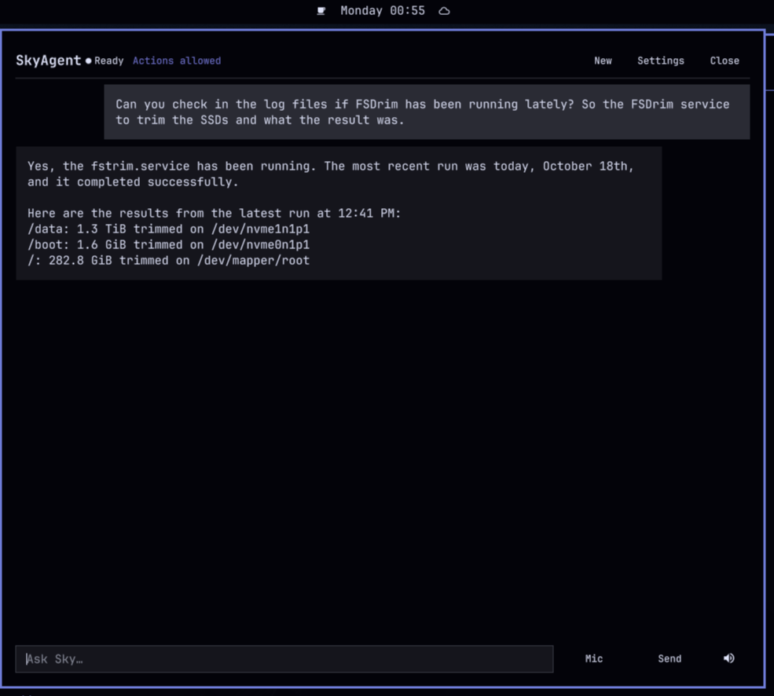

# SkyAgent

A small Omarchy/Quickshell bar plugin that lets you talk to
[`basicagent`](https://github.com/henksys/basicagent) with your voice and
hears the answer spoken by the local Kokoro TTS API.

- Hold **F10** to talk; release to transcribe, ask, and speak.
- A scrollable conversation panel, opened by clicking the bar icon.
- Voices come from Kokoro; the default is `af_sky` (“Sky”).
- Conversation history, facts, and session logs stay in basicagent.
- “New conversation” starts a new basicagent session; older sessions remain
  available in basicagent-web.
- Optional `--yes` switch for guarded tool actions, off by default.

SkyAgent does **not** modify the configuration of basicagent, voxtype, or
Kokoro. It only calls their existing interfaces.



Repository: <https://github.com/henksys/omarchy-skyagent>

## Requirements

- Omarchy with the Quickshell shell
- `basicagent` (tested with 1.3.6)
- `voxtype` daemon (tested with 1.1.1)
- Kokoro TTS API on `http://127.0.0.1:8880` (OpenAI-compatible)
- `curl` and `ffplay` (from ffmpeg)
- `bash` (used for the basicagent session wrapper); `jq` is not required at
  runtime.

## Install

### From GitHub

```sh
omarchy plugin add https://github.com/henksys/omarchy-skyagent.git --enable
```

### Development / local checkout

```sh
git clone https://github.com/henksys/omarchy-skyagent.git
ln -s "$PWD/omarchy-skyagent" "$HOME/.config/omarchy/plugins/io.github.henksys.skyagent"
omarchy plugin enable io.github.henksys.skyagent --section right
omarchy restart shell
```

The plugin defaults to the right side of the bar. Move it with the normal
Omarchy bar controls, for example:

```sh
omarchy bar move io.github.henksys.skyagent --section center --index 0
```

### F10 shortcut

Add this to `~/.config/hypr/bindings.lua`:

```lua
if o.cmd_present("omarchy-shell") then
  o.bind("F10", "SkyAgent: hold to talk", "omarchy-shell skyagent voiceStart")
  o.bind("F10", "SkyAgent: stop and ask", "omarchy-shell skyagent voiceStop", { release = true })
end
```

Then reload Hyprland (`hyprctl reload`) or restart the session.

F9 remains the normal voxtype push-to-talk key. F10 is free by default.

## Usage

- **Click the bar icon** to open the conversation panel.
- **Hold F10** to record. Release to transcribe and send. No Enter is needed.
- While recording, voxtype’s normal OSD is shown; the SkyAgent bar icon changes
  to a microphone.
- The answer streams into the panel and is spoken with Kokoro.
- Press F10 again while Sky is speaking to interrupt and ask a new question.
- The **Mic** button in the panel is a click-to-toggle alternative.
- **Stop** cancels the current answer and speech.
- **New** starts a new basicagent session. Old sessions are not deleted; they
  stay in basicagent-web.

## Settings

Settings are stored in `~/.config/skyagent/config.json` (mode 0600) and apply
immediately.

| Setting | Default | Notes |
|---|---|---|
| Voice | `af_sky` | Fetched live from Kokoro; 54 voices |
| Speed | `1.0` | 0.5–2.0 |
| Speak replies | on | Can also be toggled from the composer |
| Open panel after voice | on | Opens after transcription, not while recording |
| Allow guarded actions | off | Passes `--yes` to basicagent for new questions |

### The `--yes` switch

By default, basicagent one-shot mode denies tool calls that need approval
(shell commands, protected writes). SkyAgent shows a “Blocked: …” notice.

Turning on **Allow guarded actions** passes `--yes` to basicagent. It applies to
**every** guarded action in that run, not just one call. It is off by default,
and the panel header shows an **Actions allowed** badge while it is on.

This switch does not change basicagent’s configuration.

## How conversation state works

SkyAgent uses basicagent’s native sessions:

- The current session ID is stored in `~/.config/skyagent/config.json`.
- Each question runs `basicagent --json --session <id>`.
- basicagent loads its own previous messages and facts, appends the new
  question and answer, and trims context according to its own
  `agent.contextChars` setting.
- The panel reads the current session file read-only to show the conversation.
- **New conversation** generates a new session ID. The previous session is
  left untouched and remains visible in basicagent-web.
- SkyAgent preserves and restores basicagent’s `last-session.txt`, so your
  terminal `basicagent --continue` keeps pointing where it did before.

There is no separate SkyAgent history file. Basicagent still owns the context policy.

## Audio transport

Kokoro is asked for **raw PCM** (`response_format: "pcm"`, 24 kHz, 16-bit mono),
not WAV. PCM lets the API stream audio while it is synthesized; SkyAgent splits
the answer into small sentence chunks and plays them with `ffplay`. The first
chunk starts as soon as it is ready, while later chunks are synthesized ahead.

If Kokoro is unavailable, the text answer still appears in the panel; the
status line reports the voice error.

## Dependencies on basicagent data

SkyAgent reads the data directory configured in
`~/.config/basicagent/config.json` (`memory.dir`, default
`~/.local/share/basicagent`). It uses:

- `sessions/<id>.jsonl` — conversation history,
- `facts.jsonl` — read and written by basicagent itself,
- `last-session.txt` — preserved/restored around SkyAgent runs.

It does not modify basicagent’s code or config.

## Development

Run the pure helper tests with:

```sh
node --test test/sky-model.test.mjs
```

The Quickshell scanner logs a harmless “module path is outside the config
folder” warning for the development symlink. A normal `omarchy plugin add`
checkout does not have that warning.

## Troubleshooting

- **“Could not start basicagent”** — the plugin invokes basicagent through
  `bash -ic` so it inherits the same `PATH` and `~/.keys` exports as your
  interactive shell. Check that `basicagent` works from a terminal.
- **“Could not start voxtype”** — check `systemctl --user status voxtype`.
- **“Voice unavailable”** — check `curl http://127.0.0.1:8880/health` and
  `systemctl --user status kokoro-tts`.
- **F10 does nothing** — check the binding in `~/.config/hypr/bindings.lua`
  and that the shell is running (`omarchy shell ping`).
- **`--yes` decisions** — turn the switch off in Settings; it applies to the
  next question.

## License

MIT. See `LICENSE`.
